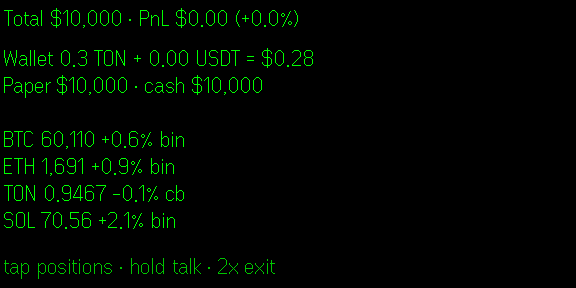
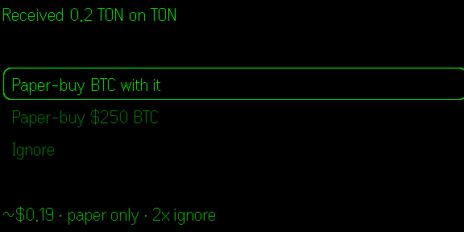
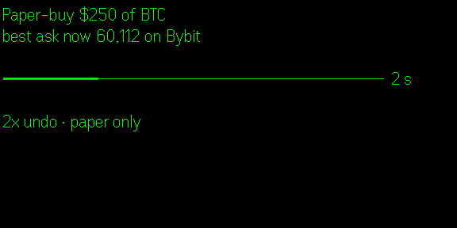
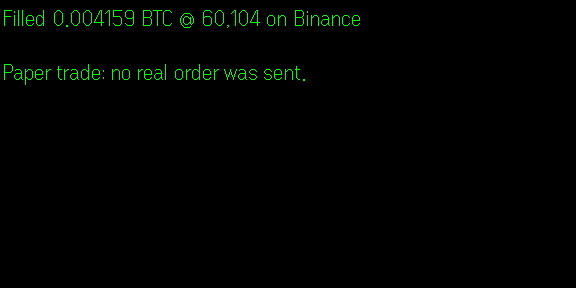
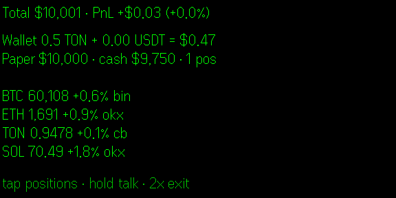
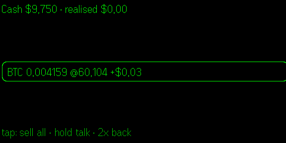
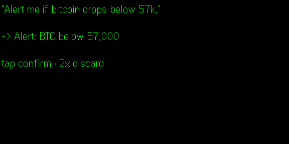
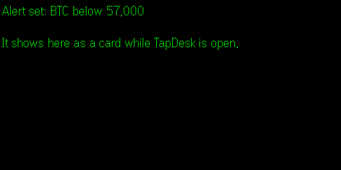

# TapDesk

[](https://github.com/samizdatproject/tapdesk/actions/workflows/test.yml)

**A trading session on Even G2 smart glasses: your TON wallet, the best live price across four exchanges, and paper orders you confirm with one tap.**

> Unofficial; not affiliated with any exchange, with TON, or with any wallet. **Paper trading only**: no real orders, no user funds, no API keys. Public market data, which may be delayed or wrong. **No financial advice.**

Built for the [Heads Up: Even Realities hackathon](https://dorahacks.io/hackathon/even-realities/detail) (Nov 23–29, 2026).

**▶ [Watch the demo video](https://samizdatproject.github.io/tapdesk/tapdesk-demo.mp4)** (1 min 5 s, captions only; file: [`docs/tapdesk-demo.mp4`](docs/tapdesk-demo.mp4)). One take in the Even Hub simulator, with a real 0.2 TON transfer to the watched wallet on TON mainnet.

## Screens from the demo

Real screens from that take (576×288).

| | |
|---|---|
|  |  |
| **Session.** Total, paper P&L, the wallet, and the best price per coin with its venue. | **Arrival.** Real TON or USDT lands in the wallet: paper-buy with it, buy a fixed $250, or ignore. |
|  |  |
| **2-second undo.** Shows the best ask right now and where. Double-tap cancels. | **Filled** at the best price across Binance, Bybit, Coinbase and OKX. Paper only. |
|  |  |
| **Updated.** Wallet and paper P&L in one glance. | **Positions.** Tap a row to paper-sell all of it. |
|  |  |
| **Hold to talk.** Transcribed by whisper.cpp on your machine, parsed by published rules, then confirmed with a tap. | **Alert set.** It comes back as a card while TapDesk is open. |

## Two tracks, one flow

TapDesk enters **03 · Exchanges & Stocks** and **02 · Crypto & DeFi (TON / Gram Wallet)**, because its core moment only works with both halves connected:

1. **USDT or TON arrives in your TON wallet** (Crypto & DeFi: the watched TON address, read-only).
2. A card appears on the glasses: **"Received 1.00 USDT on TON"**, with *Paper-buy BTC with it*, *Paper-buy $250 BTC* and *Ignore*.
3. **One tap** starts a 2-second undo. Then the paper order fills at the **best ask across Binance, Bybit, Coinbase and OKX**, and the venue is shown: "Filled 0.00001692 BTC @ 59,092 on OKX" (Exchanges & Stocks).
4. The **Session** screen shows the total (TON holdings valued at the best TON price, plus paper equity) and the paper PnL.

The money you actually received on-chain becomes the size of a trade, priced across exchanges, without touching your phone. That hand-off from wallet to market is what joins the two tracks. "Paper-buy with it" credits exactly the received amount to the paper account (once per transfer) and buys with exactly that.

## On the glasses (576×288, monochrome)

The text below is what the plugin draws (taken from its formatting code and tests; the highlighted list item is shown in brackets). Screens use ASCII signs because the glasses font drops the Unicode minus, check marks and emoji.

```
Session (root)                                   Arrival card
┌──────────────────────────────────────────┐    ┌──────────────────────────────────────────┐
│Total $10,412 · PnL +$0.70 (+0.0%)        │    │Received 1.00 USDT on TON                 │
│Wallet 10.5 TON + 1.00 USDT = $10.60      │    │[Paper-buy BTC with it]                   │
│Paper $10,002 · cash $9,750               │    │  Paper-buy $250 BTC                      │
│                                          │    │  Ignore                                  │
│BTC 58,402 +1.2% bin                      │    │                                          │
│ETH 1,661 -0.5% cb                        │    │                                          │
│TON 0.9257 -3.3% okx                      │    │                                          │
│SOL 68.64 -1.4% byb                       │    │                                          │
│tap positions · hold talk · 2x exit       │    │~$1.00 · paper only · 2x ignore           │
└──────────────────────────────────────────┘    └──────────────────────────────────────────┘
Confirm (2 s undo)                               Result
┌──────────────────────────────────────────┐    ┌──────────────────────────────────────────┐
│Paper-buy BTC with 1.00 USDT              │    │Filled 0.00001692 BTC @ 59,092 on OKX     │
│best ask now 59,092 on OKX                │    │                                          │
│                                          │    │Paper trade: no real order was sent.      │
│━━━━━━━━━━━━────────────  1 s             │    │                                          │
│                                          │    │                                          │
│2x undo · paper only                      │    │                                          │
└──────────────────────────────────────────┘    └──────────────────────────────────────────┘
```

- **Session** (root): the total, paper PnL, the wallet line, paper equity and cash, and up to four watchlist rows: best ask, 24 h change and the venue that has it (`bin` Binance, `byb` Bybit, `cb` Coinbase, `okx` OKX). It updates in place every ~3 s. Tap opens Positions, hold to talk, double-tap exits. The glasses menu has Positions, Voice command and Refresh.
- **Arrival card**: the three options above. Double-tap ignores it.
- **Confirm**: every order and every alert waits 2 seconds; double-tap (or opening the menu) undoes it. A refusal ("No fresh BTC price right now", "Not enough paper cash") shows the reason with *tap retry*; a retry reuses the order id, so the server can never fill it twice.
- **Alert card**: "ALERT  BTC below 57,000 · Now 56,940". Tap to dismiss.
- **Hold to talk**: the transcript and the parsed command ("-> Alert: BTC below 57,000"), then a tap to confirm, then the undo window for orders and alerts. Nothing runs without that tap.
- **Positions**: "BTC 0.004282 @58,391 +$0.47". Tapping a row offers *Paper-sell all* through the same undo window.

Cards that arrive while you are confirming or talking wait in a queue and show when you are back on Session.

### Voice commands (rule-based, no LLM)

Transcribed by whisper.cpp on your own machine, then parsed by fixed rules ([`backend/tapdesk/commands.py`](backend/tapdesk/commands.py)):

| Say | Confirm screen |
|---|---|
| "alert me if BTC drops below 57k" | Alert: BTC below 57,000 |
| "alert when ton goes above 1.8" | Alert: TON above 1.8 |
| "buy 100 dollars of TON" / "buy $100 of TON" | Paper-buy $100 of TON |
| "buy 0.01 bitcoin" | Paper-buy 0.01 BTC |
| "sell half my ETH" / "sell all ton" / "sell 25% of my solana" | Paper-sell half your ETH … |
| "how am I doing" / "pnl" | Open session |

Numbers can be spoken as "57k", "57,000" or "fifty seven thousand"; coins as bitcoin/btc, ether/eth, toncoin/ton, solana/sol, or any ticker on your watchlist. Anything else gets "Didn't catch that" plus examples.

## How it works

```
G2 glasses ──BLE── Even Realities app (WebView: TapDesk plugin, Vite + TypeScript + Even Hub SDK)
                        │  HTTP + WebSocket to your own backend (pairing code, device token)
                        ▼
               TapDesk backend (Python: FastAPI + httpx + SQLite), on your own machine
                 ├─ prices: public tickers from Binance, Bybit, Coinbase, OKX every ~3 s
                 ├─ TON watcher: tonapi.io v2 events (toncenter v3 fallback) every ~10 s
                 ├─ paper ledger, alerts and the idempotent order log in SQLite
                 └─ whisper.cpp server on the same machine for voice commands
```

- **Best prices.** Each (venue, coin) pair is fetched with one shared HTTP client and at most four requests in flight. Best bid and best ask are taken over the venues whose quote is under 30 s old; with none fresh the row says `stale` and orders are refused. A venue that fails or lists no pair is skipped (TON trades as GRAM on Binance, Bybit and OKX, and a halted book with zero prices is ignored). Coinbase quotes in USD and is converted at Coinbase's own USDT-USD rate, so all prices are in USDT.
- **Wallet.** The TON balance and the USDT jetton balance (matched by the jetton master `EQCxE6mU…_sDs`, never by name), and new incoming transfers. Scam-flagged events, failed or bounced-back transfers, transfers to yourself and dust are ignored. The time and ids of the newest event seen are kept in SQLite, so a restart never replays old transfers, and the first look at a new address only sets that cursor. Only amount, symbol, event id and time are stored; comments and senders are not. If tonapi fails, toncenter v3 takes over; the two sources time events differently, so each keeps its own cursor, and both name an event by the same trace id, so a transfer seen by both makes one card.
- **Paper account.** Starts with 10,000 paper USDT. Market buys fill at the best ask, sells at the best bid, and the venue is recorded. Positions keep their cost basis; PnL is equity minus the starting cash and any credited transfers, so a deposit never counts as profit. No leverage, and orders bigger than the paper cash are refused. Orders are idempotent by `clientMsgId` (a primary key in SQLite, so even a retry after a restart can't fill twice).
- **Alerts** are checked on every price tick against the mid price and fire once. G2 can't show anything while the app is closed, so cards that fire (or transfers that arrive) meanwhile appear when you open it.

## Phone screen

Pair with the backend's 6-digit code; set the TON address (checked locally with its CRC, so a typo is caught before anything is polled); edit the watchlist and the alert list; reset the paper account (asks for a second tap); unpair.

## Setup

Requirements: Python 3.11+, Node 22.13+, and optionally [whisper.cpp](https://github.com/ggml-org/whisper.cpp) for voice commands. No accounts and no API keys.

```bash
# 1. backend
cd backend
python3 -m venv .venv && .venv/bin/pip install -r requirements.txt
mkdir -p -m 700 ~/.config/tapdesk
echo 'TAPDESK_TON_ADDRESS=UQ...your address...' > ~/.config/tapdesk/tapdesk.env   # optional; also settable on the phone
TAPDESK_ENV=~/.config/tapdesk/tapdesk.env .venv/bin/python -m tapdesk serve        # :8788, prints a pairing code

# 2. speech-to-text (optional)
whisper-server -m models/ggml-base.en.bin --host 127.0.0.1 --port 8080

# 3. plugin
cd ../plugin && npm install && npm run dev      # :5174
# then run the Even Hub simulator against http://localhost:5174 (see plugin/README.md)
```

Or start everything at once with `scripts/run-local.sh` (set `WHISPER_SERVER` and `WHISPER_MODEL` to include whisper). `python -m tapdesk pair` prints a new pairing code. `backend/.venv/bin/python scripts/live_check.py` prints the current best prices and the status of your TON address once, against the live public APIs.

`npm run pack` in `plugin/` builds `tapdesk.ehpk`. It whitelists `http://localhost:8788` and `ws://localhost:8788`; for real glasses, put the backend behind TLS (for example `tailscale serve 8788`), add that `https://`/`wss://` origin to `plugin/app.json` and re-pack. The device token is as powerful as the backend, so pair only your own phone.

### Demo script and test arrivals

`scripts/demo.py --token-file <file with a device token> --step --shots shots/` drives the simulator's automation API (`:9898`) through the core moment scene by scene; `--from N` starts at scene N. By default it waits for a real transfer to the watched address. For rehearsals only, the backend can make a test card: start it with `TAPDESK_TEST_ARRIVALS=1` and run the demo with `--test-arrival`. Test cards say "(test)" on the glasses, and the endpoint does not exist unless that variable is set.

## Limits

- Paper only. Prices are top-of-book tickers, not order books: a fill uses the best quoted price for any size, with no fees or slippage.
- USDT is the quote currency everywhere; Coinbase USD prices are converted at its USDT-USD rate.
- Best bid and best ask come from different venues, and the quotes are real, so the best bid can briefly sit above the best ask. A paper buy can then show a small instant profit; real cross-venue trading would pay fees and transfer costs that the paper account ignores.
- One watched TON address (mainnet). Only TON and USDT transfers make cards. Keyless tonapi/toncenter limits are about one request a second, so new transfers show within ~10–20 s.
- Cards can't reach the glasses while the app is closed; they wait until it is opened.
- Voice commands understand the patterns above, in English.

## What existed before Nov 23

**Nothing for TapDesk**: no code, design or notes existed before the hackathon; this repository was started on Nov 25, 2026. Code patterns (pairing with hashed device tokens, the WebSocket hub and session structure, local whisper.cpp transcription, the Even bridge and input normalisation, the screen manager, the confirm-with-undo flow, hold-to-talk dictation and the phone-screen layout) were reused from our own TapBack entry, written from Nov 23, 2026 and MIT-licensed: [github.com/samizdatproject/tapback](https://github.com/samizdatproject/tapback).

**Third-party code:** Even Hub SDK (MIT), FastAPI, uvicorn, httpx, whisper.cpp, Vite, TypeScript and vitest, all under their own licenses. Market data comes from the public APIs of Binance, Bybit, Coinbase and OKX; chain data from tonapi.io and toncenter.com.

**How it was built:** with AI coding assistance (Claude), disclosed here. TapDesk itself uses no AI at runtime: voice commands are parsed by fixed rules.

## License

MIT
